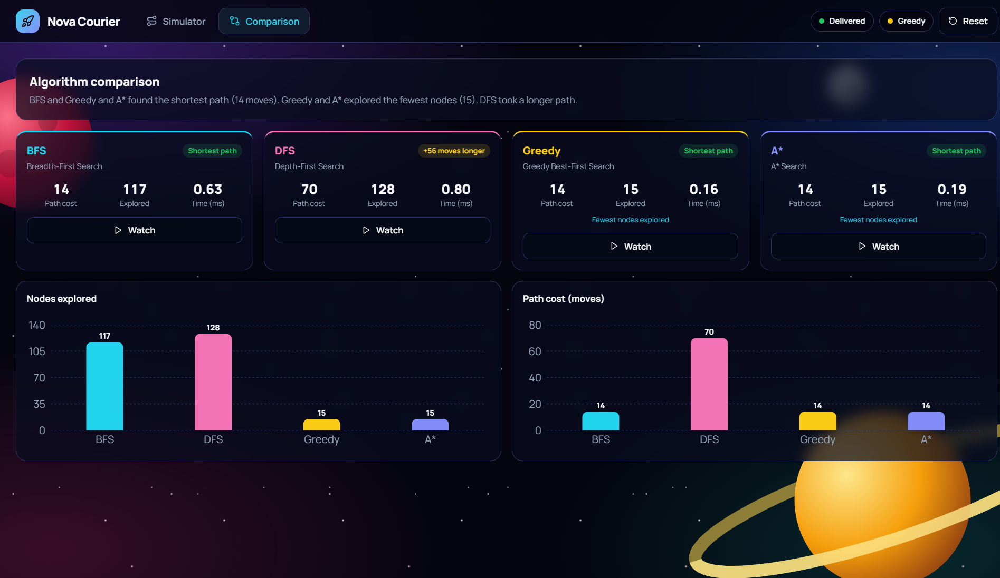
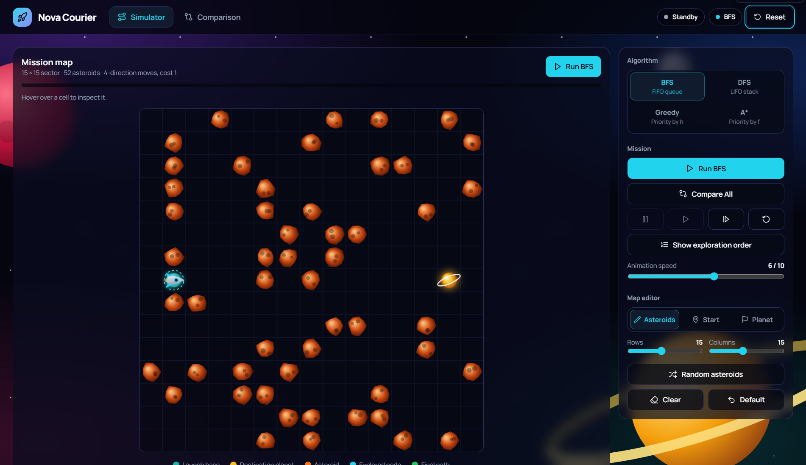
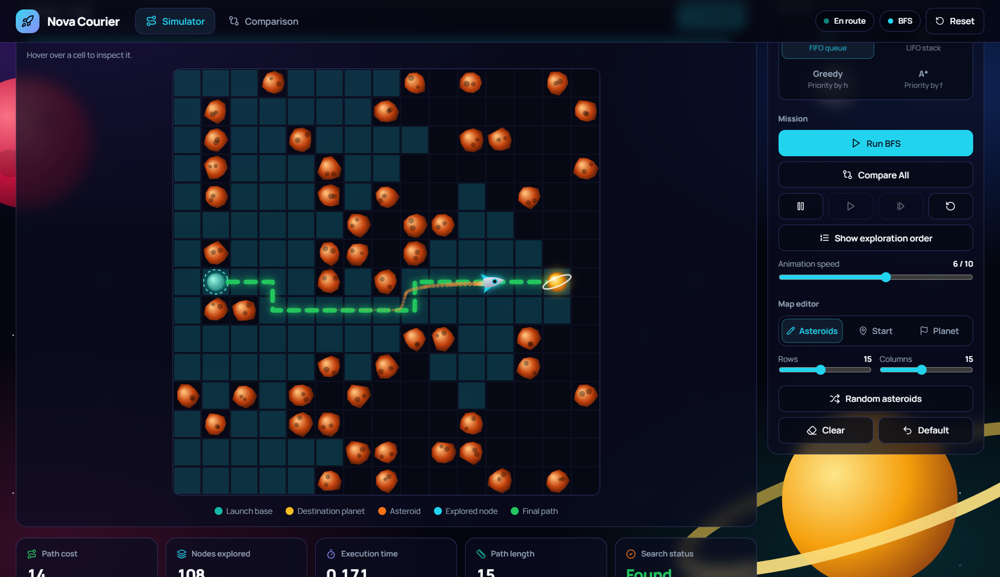
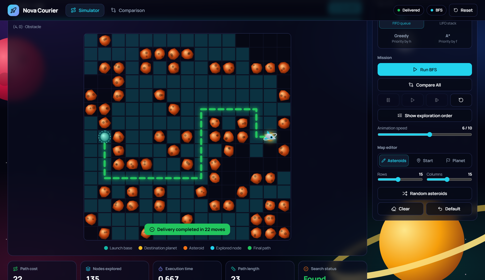
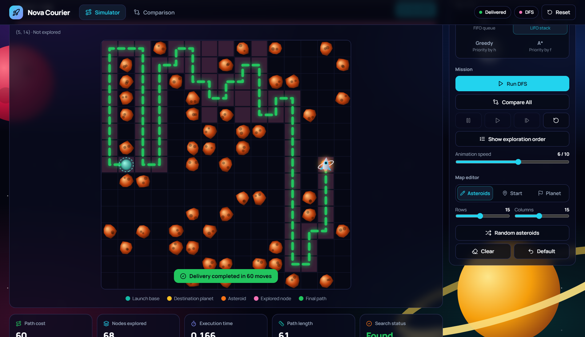
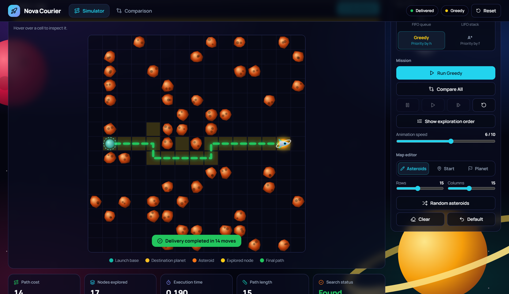
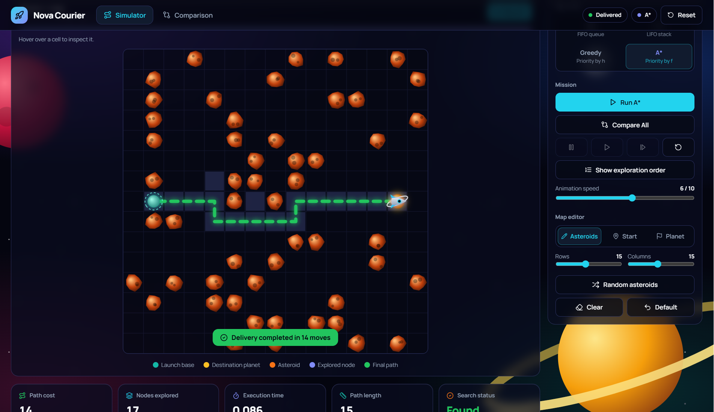
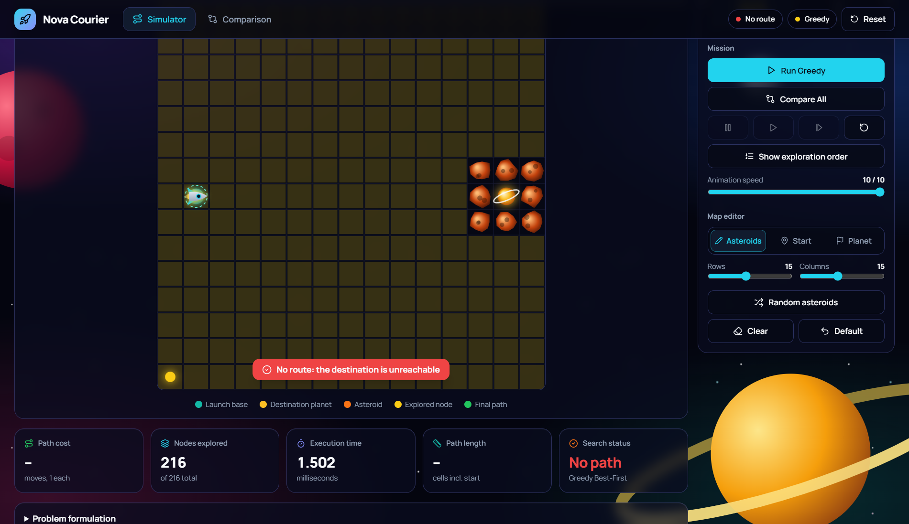
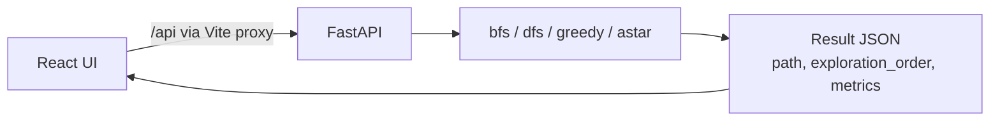

<div align="center">

# 🚀 Smart Delivery Robot

### BFS · DFS · Greedy Best-First · A\* Search

A space-themed web simulator (**Nova Courier**) that animates and compares four classic search algorithms on the same grid map.


**CF321 · Fundamentals of Artificial Intelligence · Innovation University**

[Overview](#-overview) · [Screenshots](#-screenshots) · [Algorithms](#-algorithms) · [Quick start](#-quick-start) · [API](#-api) · [Team](#-team)

<br>



</div>

---

## 📖 Overview

A delivery rocket must travel from a **launch base** to a **destination planet** on a grid full of asteroids. The Python (FastAPI) backend runs the real search algorithms; the React dashboard animates the **exact exploration order** returned by the backend and compares the results.

| Page | What it shows |
|---|---|
| 🛰️ **Simulator** | Animated space map (canvas, 60 fps), controls, live metrics, map editor |
| 📊 **Comparison** | Result cards and charts for all four algorithms, with a **Watch** button to replay any route |

**Highlights**

- ✅ Four algorithms on **identical maps** with identical movement rules
- ✅ Editable map: asteroids, start, planet, size from 3 × 3 up to larger grids
- ✅ Discussion tools: exploration order numbers and a per-cell inspector (g, h, f)
- ✅ Handles edge cases: no path, start = goal, invalid input

---

## 📸 Screenshots

<table>
<tr>
<td align="center" width="50%"><br><b>Initial map</b><br><sub>15 × 15 sector, 52 asteroids</sub></td>
<td align="center" width="50%"><br><b>BFS animation</b><br><sub>Rocket flying along the final path</sub></td>
</tr>
<tr>
<td align="center"><br><b>BFS result</b><br><sub>Optimal path, many nodes explored</sub></td>
<td align="center"><br><b>DFS result</b><br><sub>Complete but not optimal (long winding path)</sub></td>
</tr>
<tr>
<td align="center"><br><b>Greedy Best-First</b><br><sub>Priority by h only</sub></td>
<td align="center"><br><b>A\*</b><br><sub>Priority by f = g + h</sub></td>
</tr>
<tr>
<td align="center"><br><b>Comparison page</b><br><sub>All four algorithms, same map</sub></td>
<td align="center"><br><b>No-path case</b><br><sub>Destination enclosed by asteroids</sub></td>
</tr>
</table>

---

## 🧠 Problem formulation

| Element | Definition |
|---|---|
| **Initial state** | The robot is on the start cell |
| **Goal state** | The robot is on the destination cell |
| **State space** | Every free (non-obstacle) cell of the `rows × cols` grid |
| **Actions** | Up, down, left, right |
| **Transition model** | Move to the neighbouring cell if it is inside the grid and not an obstacle |
| **Path cost** | Number of moves, every move costs 1 |
| **Constraints** | No diagonal moves, no obstacles, no leaving the grid |

---

## 🔍 Algorithms

| Algorithm | Data structure | Optimal? | Complete? | Complexity | Notes |
|---|---|:---:|:---:|---|---|
| **BFS** | FIFO queue (`collections.deque`) | ✅ | ✅ | O(V+E) time, O(V) space | Level by level, optimal when all moves cost 1 |
| **DFS** | LIFO stack (explicit) | ❌ | ✅ (finite grid) | O(V+E) time, O(V) space | Returns the first path found |
| **Greedy Best-First** | Priority queue (`heapq`) by **h** | ❌ | ✅ (finite grid) | O(E log V) worst case | Fast, can be lured into dead ends |
| **A\*** | Priority queue (`heapq`) by **f = g + h** | ✅ | ✅ | O(E log V) worst case | h = Manhattan distance (admissible here) |

> A\* often explores fewer nodes than BFS, but this is not guaranteed on every map.

<details>
<summary><b>Conventions shared by all four algorithms</b></summary>

- **Move order:** up, down, left, right (`MOVES` in `backend/utils/grid.py`). This decides tie-breaks and which equal-cost path is returned.
- **Explored node** = a node removed from the frontier and expanded. The goal node counts as explored.
- **Path cost** = number of moves = path length (cells) − 1.
- **DFS:** neighbours are pushed in reverse so "up" is tried first.
- **Greedy:** priority = h only, ties by insertion order.
- **A\*:** priority = f, ties by lower h, then insertion order.
- **Optimality:** BFS and A\* are optimal here. DFS and Greedy are complete on a finite grid (visited set) but not optimal.

</details>

---

## 🛠️ Quick start

### ⚡ Windows (one click)

Double-click **`run.bat`**. It installs Python and Node packages, starts both servers and opens the dashboard.
Run `run.bat test` to execute all tests.

### 🔧 Manual

**Backend** (terminal 1)
```bash
cd backend
python -m venv .venv
.venv\Scripts\activate
pip install -r requirements.txt
uvicorn main:app --reload --port 8000
```

**Frontend** (terminal 2, Node.js 18+)
```bash
cd frontend
npm install
npm run dev
```

Open **http://localhost:5173** · API docs at **http://127.0.0.1:8000/docs**

---

## 🏗️ Architecture



**Tech stack:** React, TypeScript, Vite, Tailwind CSS, Framer Motion, Lucide React, Recharts · Python, FastAPI, Uvicorn, pytest

---

## 🗂️ Where to find things

| What | File |
|---|---|
| BFS / DFS / Greedy / A\* | `backend/algorithms/bfs.py`, `dfs.py`, `greedy.py`, `astar.py` |
| Movement rules and neighbours | `backend/utils/grid.py` |
| Result format, path cost, timing | `backend/utils/metrics.py` |
| API endpoints and validation | `backend/main.py` |
| Animation logic (replays the real exploration order) | `frontend/src/hooks/useSimulation.ts` |
| Map drawing and rocket movement | `frontend/src/components/SpaceMap.tsx` |

---

## 🎓 Demo tools for the discussion

- **Show exploration order:** writes 1, 2, 3, … on the explored cells (1 = start) so a case can be traced by hand and checked against the program.
- **Cell inspector:** hover a cell to see its state, exploration number and its g, h and f values (f only for A\*). The numbers come from the algorithm, not from the UI.
- **Problem formulation panel:** below the metrics on the Simulator page.
- **Small grids:** as small as 3 × 3, so an examiner-chosen case can be drawn exactly.

<details>
<summary><b>Live-change cheat sheet</b></summary>

Results marked *(measured)* were checked on random maps in this project; the rest follow from theory.

| Change | Effect |
|---|---|
| Reorder or reverse `MOVES` | BFS and A\* path **cost** stays the same *(measured on 100 maps)*. The chosen path, tie-breaks, DFS route and exploration order can change. |
| Make `manhattan()` in `astar.py` return 0 | A\* loses its guidance but still returns the optimal cost, same as BFS *(measured on 300 maps)*. |
| Multiply `manhattan()` by 3 (not admissible) | A\* returned a longer-than-optimal path on 66 of 300 random maps *(measured)*. |
| Add diagonal moves with cost 1 | Manhattan distance overestimates, so A\* is no longer guaranteed optimal. The tests assert the 4-direction rule and will fail on purpose. |
| Order Greedy by f = g + h instead of h | It becomes A\*. |

</details>

---

## 🔌 API

`GET /api/health` · `POST /api/bfs` · `/api/dfs` · `/api/greedy` · `/api/astar` · `/api/compare`

`/api/compare` returns `bfs`, `astar`, `dfs`, `greedy`.

**Request body** (coordinates are `[row, col]`)
```json
{ "rows": 15, "cols": 15, "start": [7, 1], "goal": [7, 13], "obstacles": [[3, 6]] }
```

**Response fields**

| Field | Meaning |
|---|---|
| `algorithm`, `status` | Algorithm name, `"found"` or `"no_path"` |
| `path`, `exploration_order`, `explored_cells` | Final route and the order nodes were expanded |
| `path_cost`, `explored_count`, `execution_time_ms` | Metrics |
| `g_values`, `h_values` | Cost so far and Manhattan heuristic of each expanded node (`h` is `null` for BFS and DFS) |

Invalid input returns HTTP 422 with a message.

---

## ✅ Testing

```bash
cd backend && python -m pytest -q     # backend
cd frontend && npm test               # map-editing logic
```

Backend tests cover: empty map, obstacles, narrow corridor, multiple paths, unreachable goal, invalid start/goal, start = goal, several grid sizes, BFS/A\* cost agreement on 60 random maps, and that `/api/compare` uses one map.

**Comparison methodology:** all algorithms receive the same validated request and the same movement rules (`utils/grid.py`). Time is measured with `time.perf_counter()` around the search only. Timings vary per run and machine, so do not draw conclusions from a single run.

---

## 👥 Team

| | Member | Student ID | Algorithm | Contribution |
|:-:|---|---|---|---|
| 👤 | **Domaduios Yousief** | 24030159 | BFS (`bfs.py`) | BFS, problem formulation, grid and movement rules (`utils/grid.py`) |
| 👤 | **Nada Magdy** | 24030024 | DFS (`dfs.py`) | DFS, FastAPI endpoints and validation (`main.py`), backend tests |
| 👤 | **Yousief Adel** | 24030021 | A\* (`astar.py`) | A\* with Manhattan heuristic, metrics (`utils/metrics.py`), comparison methodology |
| 👤 | **Salma Ahmed** | 24030027 | Greedy (`greedy.py`) | Greedy Best-First, React dashboard (Simulator and Comparison), animation, frontend tests |

All members took part in testing, preparing the README and report, and rehearsing the discussion and live tasks.

---

<div align="center">

Made with ☄️ for **CF321 · Project 1 · Search Algorithms**

</div>
